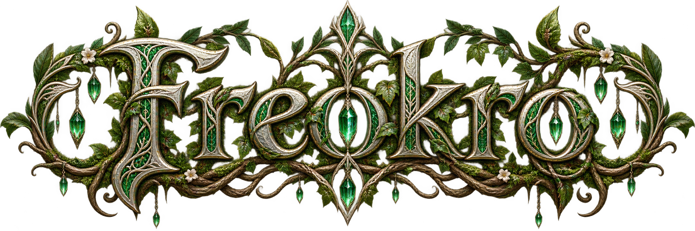
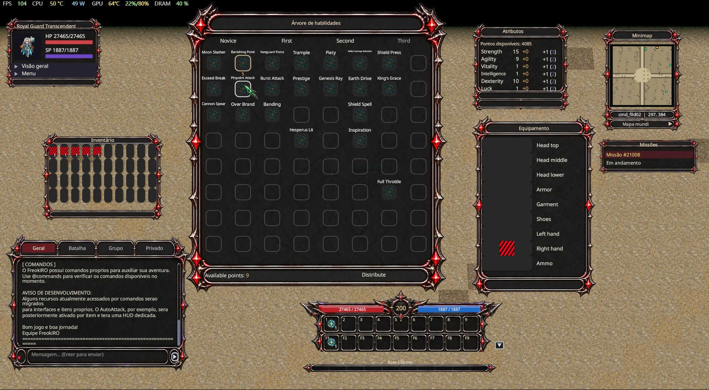
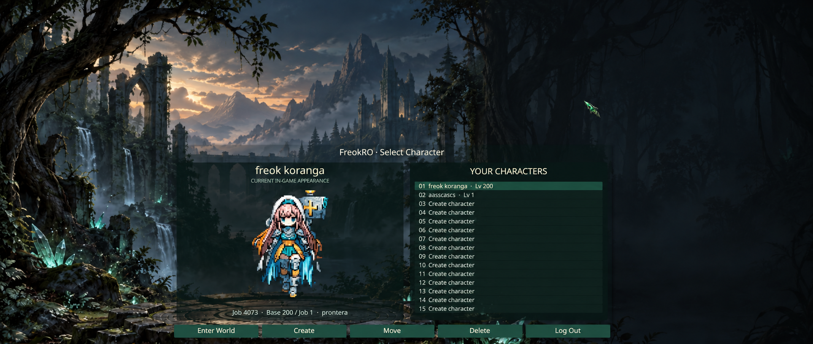
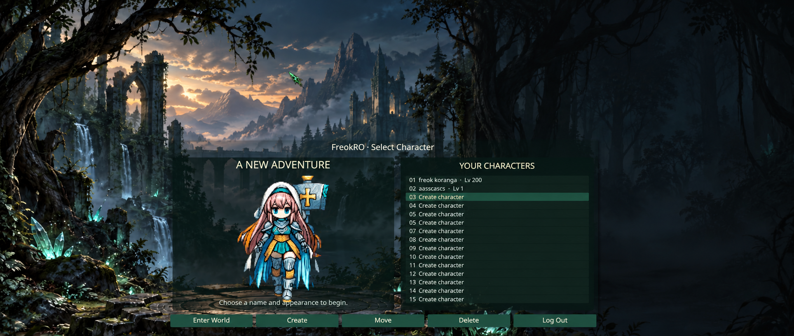
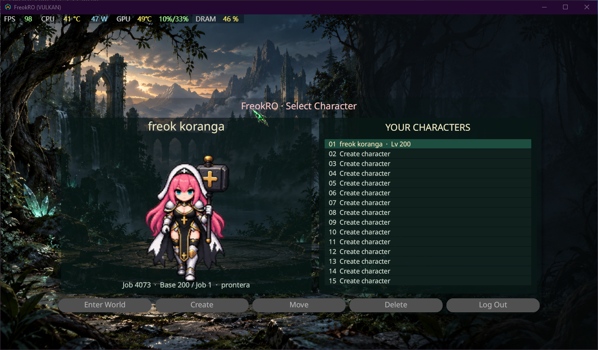
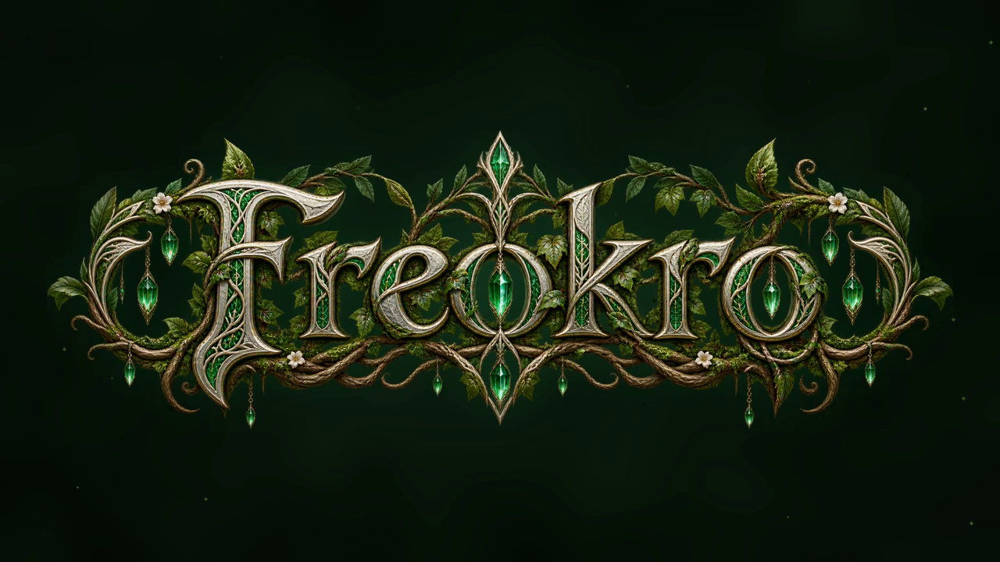
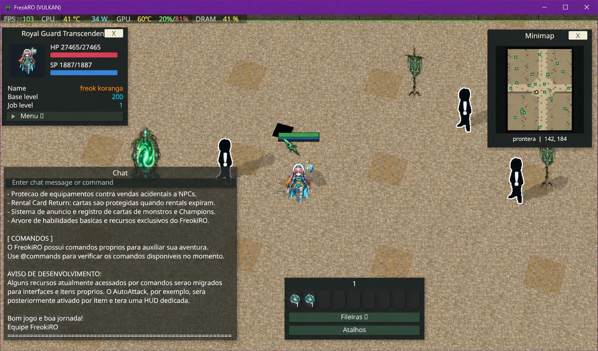
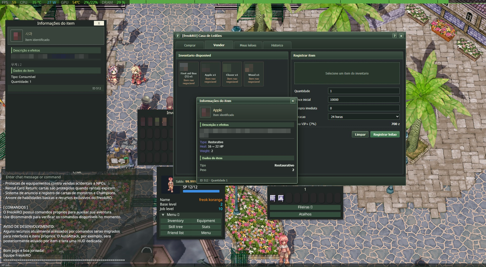
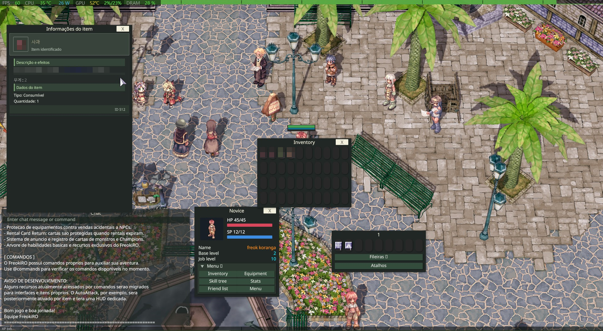

<p align="center">
  
</p>

# 🌿 FreokRO

[](https://opensource.org/licenses/MIT)

FreokRO (Free of Korean Ragnarok Online) is a custom game project with its own visual identity. Its client adapts [Korangar](https://github.com/vE5li/korangar), a Rust Ragnarok Online client with real-time lighting and a customizable interface. Upstream Korangar supports Linux, Windows, and macOS; the FreokRO build and local installation documented here were validated on Windows.

The emblem above is the project's visual direction. The FreokRO branch now contains original flat RSW, GND, and GAT drafts for every active map. See the [map-authoring model](map-authoring/README.md) and [technical status](TECHNICAL_STATUS_FREOKRO.md) for installation and validation details.

## 🌿 FreokRO development branch

The [`freokro` branch](https://github.com/piabapiaba801/korangar/tree/freokro) contains the personalized **FreokRO** client, including its original HUD artwork and current interface work. These changes were developed in a separate private workspace and are now deliberately published on this branch at the owner's request. The simplified `freokro-base` remains a separate local candidate; publishing this branch does not turn that candidate into a completed release.

## 🚧 Work in progress — October 15, 2026

### Controls and native services — October 15, 2026

The existing **Alt + key** window shortcuts remain the interface standard. New service windows follow it.

| Action | Default input |
| --- | --- |
| Walk, including diagonals | W / A / S / D; suspended while typing, in dialogs, or using Alt shortcuts |
| Upper action row | Physical right-hand Numpad 1–9 |
| Lower action row | F1–F9 |
| Character / Inventory / Skill Tree / Attributes | Alt+C / Alt+E / Alt+S / Alt+A |
| Equipment / Friends / Minimap | Alt+Q / Alt+Z / Alt+M |
| Mailbox / Companion | Alt+L / Alt+J |
| Social and party management / Guild / Direct trade | Alt+P / Alt+G / Alt+T |
| Auction / Skill binding editor | Alt+B / Alt+K |

The owner has validated WASD, physical Numpad shortcuts and F1 in game. Friends is provisionally accepted for the functions tested so far. The Guild, Mailbox and Companion spacing/footer corrections and the auction tradability repair require a new gameplay check.

The skill shortcut fix targets the two visible action rows. Earlier custom bindings targeted hidden rows; new bindings are stored separately in `client/hotkey_settings_v2.ron`. The original settings file is preserved. Learned skill levels constrain casts, and a selected enemy can be used when the cursor is away from it.

Native service windows cover reading mail, collecting Zeny/items and deleting empty letters; pet hatching, target selection for taming/catalog skills, feeding, performance, renaming, accessory use/removal, returning to an egg, and server-confirmed VIP auto-feed; party creation/invitations, guild creation/invitations/member list/chat/leaving, and direct trade with separate offer locking and final confirmation. Friends, whispers, party roster/leadership and NPC shop flows retain their existing handlers. Pet combat, KO, bonuses and evolution rules remain server-authoritative; the local pet loyalty ceiling is 750.

The separate local auction agent now recognizes `FreokRO.exe` and launches from the installed client. Its bridge uses the matching server runtime directory, a login-bound expiring session token and correlated request IDs. Seller cancellation is limited to an active listing without bids, with item delivery by mail and no listing-fee refund. The history includes completed/pending sales, purchases, cancellations and expirations. Creation verifies item identity and price limits; the first bid uses the server's minimum.

**Validation:** focused control tests, packet tests, unique-header registration, Windows server/agent builds, and auction JavaScript syntax are checked locally. Gameplay acceptance is pending. The server startup test could not reach the local database because MariaDB was stopped; no financial operation was exercised against a character. The local auction bridge is for this single-machine distribution, not a remote multiplayer auction transport. Its existing escrow path crosses live inventory and SQL; crash recovery of `ESCROW_PENDING` still requires an inventory/listing audit and must not be described as fully atomic.

### Current in-game HUD — October 15, 2026

The latest owner-provided screenshot records the current FreokRO interface: matching black steel and red gemstone frames for character status, chat, Inventory, Equipment, Attributes, Skill Tree, Minimap, and Quests, together with HP/SP, two action rows, and the restored ten-segment base EXP bar. The Skill Tree has eight columns and at least eight rows, a clear draggable header, and points/distribution controls inside its bottom rail.

The HUD's Portuguese interface labels have now been translated into familiar English RPG terms, including **Overview**, **Skill Tree**, **Attributes**, **Stat Points**, **Inventory**, **Equipment**, **World Map**, **Quests**, and chat channels **General / Combat / Party / Whisper**. The screenshot below was captured immediately before this text-only update and still shows the previous Portuguese labels. The English build requires a new in-game text check.



The deployed Windows client and its launcher are named **FreokRO** (`FreokRO.exe`). The technical build package retains its existing internal `korangar` name.

- **Playable local visual checkpoint:** the owner confirmed the redesigned login, world selection, character selection/creation, and lateral movement in the independent test client. Occupied slots display the selected character's current in-game sprite; an empty slot displays the creation preview.
- **Authored map baseline:** all 1,265 active map names have project-generated RSW, GND, and GAT triplets. Names and dimensions remain compatibility references. Navigation, warps, and visual details still need map-by-map work.
- **Temporary character art:** turquoise Azuk has front and side frames. Rear/diagonal views, hair and class variants, equipment, NPCs, and monsters still need original art. The male character remains a static original placeholder.
- **Separate release lines:** `freokro` is the personalized working client, now published on the branch linked above. The simplified `freokro-base` repository has its own history and includes the generated maps; its release checks remain separate.
- **Themed in-game HUD:** a Devilian-inspired skin changes the camera pitch, character status, target HP, party panel, quest tracker, larger current-area map panel, central HP/SP, two skill rows, and base EXP shown in exactly ten segments. Party actions use the 20220406 server protocol. A global atlas remains to be built. The existing map files, character sprites, and login/world/character screens are unchanged. The earlier Classic skin remains selectable.





*Presentation edits remove the Windows taskbar and desktop overlays from these two captures.*

## 🌱 Point zero: a Ragnarok-like Plus foundation

FreokRO is the starting point for a **“Ragnarok-like Plus”**: a playable client and emulator foundation from which a new game can grow. The phrase describes its roots, not a fixed design. Creators can build new worlds, art, interfaces, progression, combat, social systems, or take the project in another direction entirely. This branch is the **point zero** of that work, not a finished game or a prescribed final form.

The long-term goal is to release a reusable base that distributes **no Gravity-owned game assets or other Gravity intellectual property**. That goal has **not yet been reached**. The map replacement, original art, and asset audit are still in progress; some technical map names and coordinates remain as migration references. The current repository state is described in the [technical status](TECHNICAL_STATUS_FREOKRO.md), and users must provide any compatible third-party assets they choose to use during development.

When the client and the [FreokRO rAthena emulator](https://github.com/piabapiaba801/freokro-rathena-korangar) are stable enough to serve as that public base, development will move from frequent foundational commits toward a slower maintenance cadence: fixes, compatibility updates, documentation, and deliberate new features.

## 🧩 FreokRO adaptation

`freokro` is the active personalized development branch, published to the [Korangar fork](https://github.com/piabapiaba801/korangar/tree/freokro) and mirrored in the private workspace repository. The fork retains `dev`, `rebase`, and `main` as separate branches. The client requires the [FreokRO rAthena fork](https://github.com/piabapiaba801/freokro-rathena-korangar), configured for protocol `20220406` without packet obfuscation. The original Ragexe line uses `PACKETVER 20250716` and runs separately.

The [FreokRO Auction HUD](https://github.com/piabapiaba801/freokro-auction-hud) is a separate process in a **private** repository. The base game does not require it; the **Black Market** interface does. The server handles **Black Market (7007)** and opens the local HUD bridge when the skill is used in town. This client implements the regular item and equipment windows. Check protocol, skill, and auction changes across all three projects.

### 📥 Downloads and Windows requirements

| Purpose | Official dependencies |
| --- | --- |
| Play with prebuilt binaries | Install [MariaDB Server](https://mariadb.org/download/) and the [Visual C++ Redistributable v14 x64](https://learn.microsoft.com/en-us/cpp/windows/latest-supported-vc-redist?view=msvc-170) for the [FreokRO server](https://github.com/piabapiaba801/freokro-rathena-korangar). Prepare compatible game assets from your own installation. |
| Build this client | Install [Rustup](https://rustup.rs/) (`rust-toolchain.toml` selects `nightly-2026-02-01`), [Git for Windows](https://git-scm.com/install/windows), [Slang `slangc`](https://github.com/shader-slang/slang/releases) **2025.18.2 or newer**, and [NASM](https://www.nasm.us/) in `PATH`. The [LunarG Vulkan SDK](https://vulkan.lunarg.com/sdk/home) is another source for `slangc`. Rust may also request the [Visual Studio MSVC prerequisites](https://rust-lang.github.io/rustup/installation/windows-msvc.html). |
| Use the auction | In addition to the server and client, install the [private HUD](https://github.com/piabapiaba801/freokro-auction-hud), [.NET Desktop Runtime 8 x64](https://dotnet.microsoft.com/en-us/download/dotnet/8.0), and the [WebView2 Evergreen Runtime](https://developer.microsoft.com/en-us/microsoft-edge/webview2/). |

`slangc` is needed **to compile shaders**, as specified by `korangar/build.rs`; it is not required separately to start an already-built executable. This repository does not distribute `data-freokro.7z` or other game assets.

### 🏗️ Build

The reference build on Windows is:

```powershell
cargo +nightly-2026-02-01 build --release --locked -p korangar --features unicode,debug
```

Upstream Korangar's build requirements also apply. Game assets, local server configuration, and the deployed executable stay outside this source repository. The old local `data-freokro.7z` package was removed from the physical game copy.

### ▶️ Run and validate

The in-game menu includes **Skin**. **Devilian** is the default for a fresh private installation; **Classic** retains the green palette and **Original** retains the previous theme. Existing installations keep the skin saved in `client/interface_settings.ron` until it is changed in the menu. Item descriptions preserve Ragnarok color codes, render separator lines, and show equipped card icons when their sprites load.

Prepare assets in the installation directory, start the database and servers before the client, and run the HUD agent to use the auction. The local **FreokRO Client (iniciar tudo)** shortcut performs that sequence but is not part of this repository. Auction window opening was confirmed. After the October 7, 2026 database schema fix, the user confirmed escrow passed in the client; bidding, buying, cancellation, and item return need separate checks. Compilation alone does not validate every feature.

### ⚡ Startup performance

Normal startup skips the full content hash of the game archives. `sync-cache` still calculates it, and debug builds can opt into verification by setting `KORANGAR_VERIFY_GAME_FILES=1` before launch. This keeps the existing cache sync hash while avoiding a full read of the multi-gigabyte archive on every ordinary launch.

In one controlled local Windows comparison on October 8, 2026, direct Vulkan launches reached a responsive window in **11.1 seconds** with the prior executable and **7.9 seconds** with the optimized build, using the same game directory. The hash phase fell from **2,961 ms** to **0 ms**. The regular DX12 launcher was observed at **15.6 seconds** before this change; the updated executable reached a responsive DX12 window in **12.6 seconds** in a separate test. These are single-run measurements and can vary with launch conditions and disk cache state. At the time, opening the now-removed `data-freokro.7z` took about **4–5 seconds**.

### 🎞️ FreokRO startup and character screens

The menus no longer load Geffen as a background map. Login plays the project-supplied eight-second video in a loop, with the FreokRO emblem already embedded in the footage. Character selection and creation use an original forest scene and separate FreokRO character art. A dark background keeps the menus usable if an asset is missing; the actual game map loads after a character enters the world.

Character selection has a roster of slots and actions for entering, creating, moving, and deleting a character. Occupied slots now render the same project-owned character sprite resources used in the world: turquoise Azuk for female characters and a temporary male sprite. Deletion requires a second click on the same character. Creation sends the chosen sex, hair style, and hair color to the server; its portrait remains illustrative and does not yet change with hairstyle or color. The initial class is **Novice**, which the current server accepts. The owner confirmed the redesigned screens and lateral movement on October 13, 2026. Enter, move, delete, and every appearance option have not been checked individually. See the [character menu art notes](art/freokro/character-menu/README.md).



The [source MP4](docs/assets/freokro-intro-source.mp4) and [runtime AV1/IVF file](korangar/client/branding/intro.ivf) are kept separately. Copy `intro.ivf` to `client/branding/intro.ivf` beside the game executable. [Video preparation notes](korangar/client/branding/README.md) explain how to convert a replacement MP4. The video has no audio; game music remains separate.



See [TECHNICAL_STATUS_FREOKRO.md](TECHNICAL_STATUS_FREOKRO.md) for the current FreokRO state. The earlier client checkpoint remains in [TECHNICAL_STATUS_DEV.md](TECHNICAL_STATUS_DEV.md).

### 🗺️ Current FreokRO map state



*Presentation edit of the in-game Prontera capture from October 9, 2026; the desktop taskbar was removed. The user confirmed that the new cursor, female character placeholder, and common skill icon work in the client. The image also shows the authored ground, original emerald portal sprite, and minimap portal markers. Black silhouettes with white outlines are still temporary NPC placeholders. This view does not establish that the map perimeter, every walkable area, or connected warps work correctly.*

The [original map-authoring batch](map-authoring/README.md) provides project-authored RSW, GND, and GAT files for all **1,265/1,265 active maps (100%)**, preserving their original dimensions. Every RSW has zero static objects, including trees and vegetation; every GND is flat with a black edge; every GAT cell is walkable. The local game loads this batch through a separate non-solid 7z archive, with a matching local rAthena map cache. The client now includes a map overview with the character marker, opened by default and toggled with **Alt+M**. The screenshot confirms that this minimap renders in Prontera. The user approved the first terrain view, then found movement blocked on some clickable areas; eight higher-priority legacy server-cache entries were identified and cleared. Movement after that server fix, the black perimeter, and connected warps still need in-game validation.

**Gravity-derived asset removal is not 100%:** the user removed the old local `data-freokro.7z`, its duplicate extraction, and the loose background music folder. Other loose assets still need an ownership and dependency audit. A reliable percentage for all Gravity-derived content is not available. [The technical status](TECHNICAL_STATUS_FREOKRO.md) separates active map replacement, local package removal, and pending work.

FreokRO now has original [portal, banner, taming, cursor, skill placeholder, and character artwork](art/freokro/sprites/README.md). The client routes the legacy portal/banner/taming identifiers to their FreokRO assets. It uses an animated emerald cursor with click, attack, dialog, and prohibited feedback. Skill icons temporarily share one FreokRO sigil while retaining their individual names and behavior. Female characters use the turquoise Azuk frontal animation and a lateral walk cycle; rear and diagonal views remain temporary. Male characters use a single project-owned placeholder frame. Hair, class, equipment, and color variants require further art. The owner confirmed the lateral movement in the October 13, 2026 test client; broader male animation and appearance behavior remain unverified. The minimap places emerald markers at static warp coordinates exported from the configured FreokRO rAthena scripts and at live warp entities sent by the server; the user also confirmed those markers in-game.

### 📸 Earlier FreokRO client captures

These October 7, 2026 captures show the locally running client. The auction is supplied by the separate private HUD. The client and auction item windows are visibly different here, so these images are a reference for the ongoing Classic skin work. Item description text and item sprites are mosaicked in both captures.



*Black Market, inventory, and item descriptions open together.*



*The client item description and inventory with the auction closed.*

## Upstream Korangar reference

The screenshots, installation pages, community links, and package overview below come from the upstream project. They may not reflect this FreokRO build or the Classic skin.

##### Upstream Korangar screenshots (not a validation of the FreokRO Classic skin)

*Geffen in the afternoon*


*Geffen at night*

## 🚀 Running

> [!IMPORTANT]
> Korangar is still very early in development and is anything but feature-complete.

If you want to try it out for yourself, check out the [Installation page](wiki/Installation.md).

## 🔧 Troubleshooting

If you're running into issues while setting up or running Korangar please check the [Troubleshooting page](wiki/Troubleshooting.md). In case your issue is not listed feel free to [create an issue](https://github.com/vE5li/korangar/issues/new) or use the dedicated `support` channel on our [Discord server](https://discord.gg/2CqRZsvKja).

## 🤝 Contributing

This is a very ambitious project and we are always looking for contributors. If you are interested, please read [this page](wiki/Contributing.md).

## 🔥 Updates

There is a dedicated channel for `updates` on our [Discord server](https://discord.gg/2CqRZsvKja). If you want to stay up to date with development or see recent changes, go check it out!

## 📦 Packages

We try to keep the project as modular as possible by splitting the codebase into individual crates. All the crates prefixed with `ragnarok-` are **independent of Korangar and have no dependencies on it**.

We encourage everyone to use these crates for their own Ragnarok Online related projects and contribute back if they want to.
